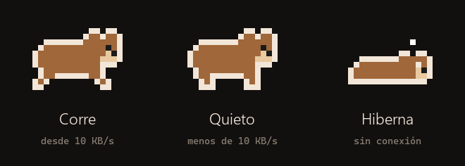

<p align="center">
  
</p>

<h1 align="center">NetBear</h1>

<p align="center">
  Un oso en pixel art que vive en la bandeja de Windows y corre según tu velocidad de internet
</p>

<p align="center">
  <a href="https://github.com/owenunda/NetBear/releases/latest"><b>Descargar</b></a>
  ·
  <a href="https://owenunda.github.io/NetBear/">Sitio web</a>
  ·
  <a href="https://owenunda.github.io/NetBear/privacidad/">Privacidad</a>
  ·
  <a href="https://owenunda.github.io/NetBear/soporte/">Soporte</a>
  ·
  <a href="https://owenunda.github.io/NetBear/en/">English</a>
</p>

<p align="center">
  
</p>

## Cómo funciona

Cada segundo NetBear mide los bytes que pasan por tus adaptadores de red y elige cómo se mueve el oso:

| Estado | Cuándo | Qué hace |
|---|---|---|
| Corre | Desde 10 KB/s | Mientras más rápido descargas, más rápido corre |
| Quieto | Menos de 10 KB/s | Espera y de vez en cuando parpadea |
| Hiberna | Sin conexión | Duerme hasta que vuelve internet |

Pasa el mouse por encima para ver `↓ descarga  ↑ subida`. Con clic derecho tienes el menú: iniciar con Windows, ver el proyecto en GitHub y salir. Se adapta solo a la barra de tareas clara u oscura.

Es un solo `.exe` de unos MB, sin dependencias ni runtime que instalar, y no envía datos a ningún servidor.

## Instalar

Descarga la última versión desde [Releases](https://github.com/owenunda/NetBear/releases/latest):

| Archivo | Para qué |
|---|---|
| `NetBearSetup.exe` | Instalador sin permisos de administrador. Agrega NetBear al menú Inicio y, si quieres, lo inicia con Windows |
| `NetBear-portable.zip` | Solo el `.exe`. Descomprímelo y ábrelo |
| `NetBear.msix` | Paquete para Microsoft Store |

Requiere Windows 10 u 11 de 64 bits.

Como el instalador todavía no está firmado, Windows SmartScreen puede mostrar "Windows protegió tu PC". Elige **Más información** y luego **Ejecutar de todas formas**.

## Limitaciones

- "Sin conexión" significa que ningún adaptador tiene puerta de enlace. Los virtuales de Hyper-V, WSL o Tailscale no cuentan. Si estás conectado al WiFi pero el router no tiene internet, el oso no hiberna: se queda quieto.
- El anclaje USB del celular cuenta como conexión real.

## Desarrollo

Necesitas el [SDK de .NET 10](https://dotnet.microsoft.com/download).

```powershell
dotnet run --project src/NetBear   # abre el oso en la bandeja
dotnet test                        # corre los tests
```

Para compilar el `.exe` Native AOT localmente necesitas además las *C++ Build Tools* de Visual Studio:
`dotnet publish src/NetBear -c Release -r win-x64`. Si no las tienes, GitHub Actions lo compila en cada push.

| Carpeta | Qué hay |
|---|---|
| `src/NetBear` | La app: Win32 directo, sin WinForms ni WPF |
| `tests/NetBear.Tests` | Tests con xUnit |
| `installer` | Script de Inno Setup |
| `packaging/msix` | Manifiesto e íconos del paquete MSIX |
| `site` | El sitio web, publicado con GitHub Pages |
| `brand` | Logo, íconos y textos de Microsoft Store |

## Dibujar al oso

Los cuadros de la animación están como texto en [`src/NetBear/Sprites.cs`](src/NetBear/Sprites.cs). Cada carácter es un pixel: `.` es transparente, y `O`, `B`, `L`, `E`, `N` y `Z` son colores de la paleta. Edita los cuadros, corre `dotnet test` para comprobar que siguen midiendo 16×16 y ábrelo con `dotnet run`.

Los PR con mascotas nuevas son bienvenidos.

## Publicar una versión

```powershell
git tag v1.0.0
git push origin v1.0.0
```

GitHub Actions corre los tests y crea una Release con el instalador, el zip portable y el paquete MSIX. El sitio web publica además cada instalador en una URL fija por versión.

## Licencia

[MIT](LICENSE)
